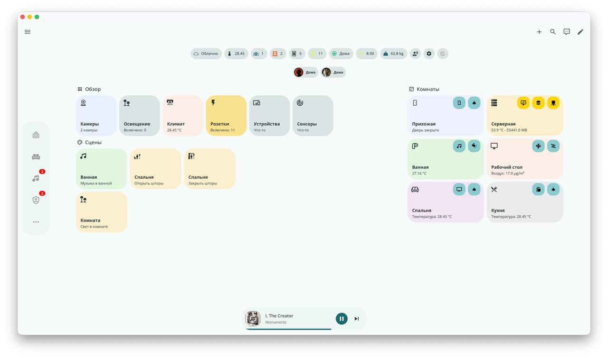
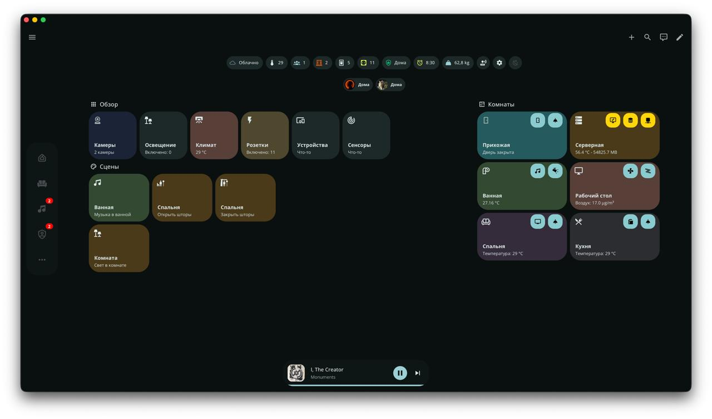

# 🏠 Home Assistant

> Персональная система умного дома  
> Репозиторий конфигурации Home Assistant

---

## 👀 Preview

| Dashboard |
|:--:|:--:|
|  |  |

---

## 🧩 Integrations

### 🔌 HACS
- Yandex Intents  
- Yandex Station  
- Yandex SmartHome  
- Yandex Dialogs  
- Yandex Pogoda  
- Adaptive Lights  
- WebRTC Camera  
- Xiaomi Home  
- OpenID  

---

### ⚙️ System
- Withings  
- Spotify  
- CalDAV  
- Synology DSM  
- Ollama  
- Apple TV  
- HomeKit  
- GitHub  
- LinkPlay  
- MQTT  
- Ping  
- Plex  
- System Monitor  
- SQL  
- Telegram  
- Xbox  
- Todo List  
- Backup  
- AdGuard Home  
- Uptime Kuma  
- Prometheus

---

## 🧱 Add-ons

- 🧑‍💻 **Studio Code Server**
- 🔐 **Terminal & SSH**
- 🛜 **Zigbee2MQTT**
- 📡 **Mosquitto Broker**
- 🗄️ **MariaDB**
- 🎥 **go2rtc**
- 📷 **Frigate**
- 🎵 **Music Assistant**
- 🗣️ **Piper (TTS)**

---

## 🎨 Themes

- **Material You**  
  └ with Utilities

---